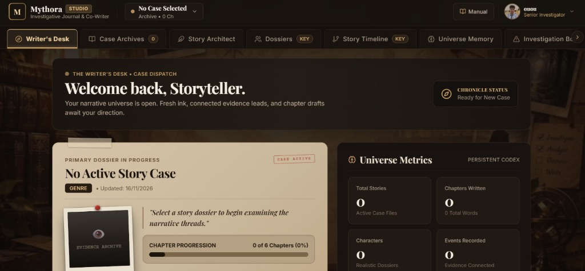
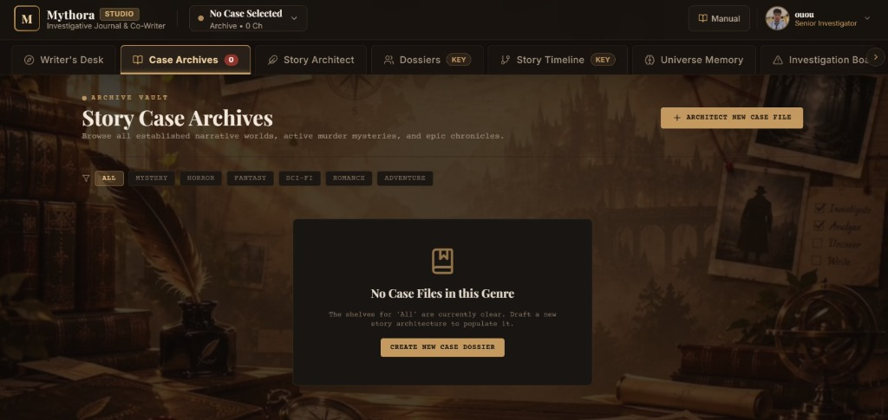
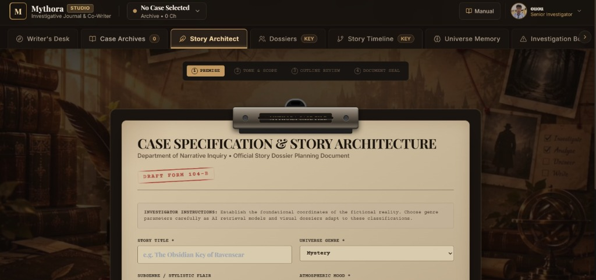
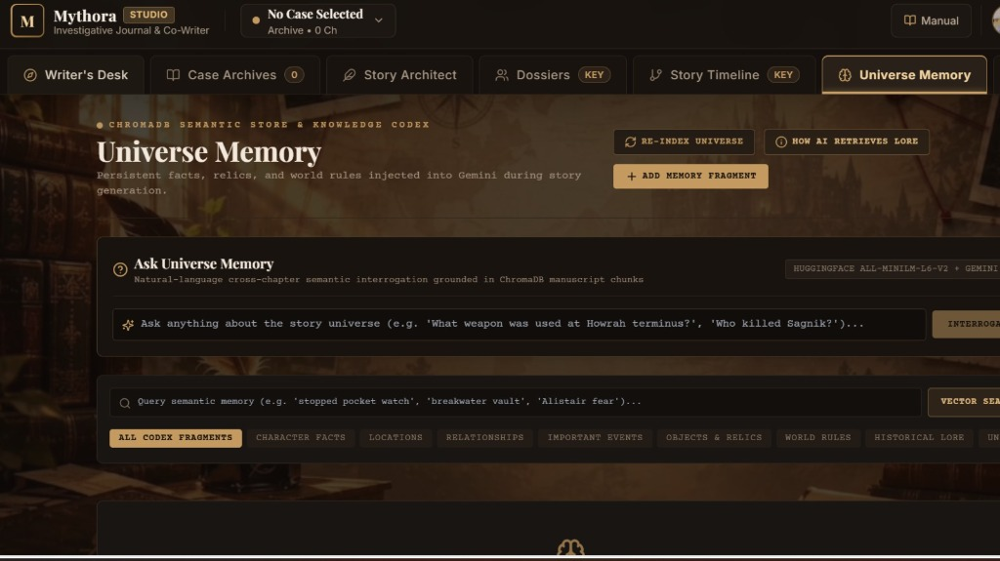
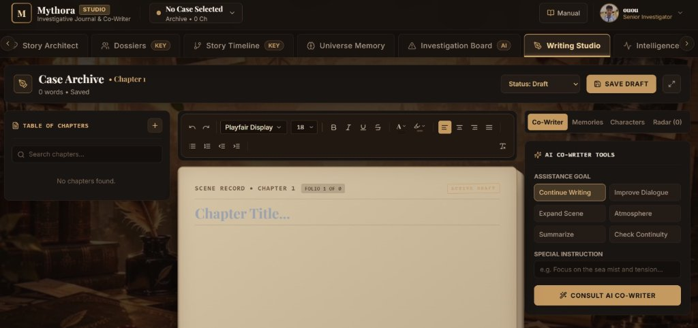

<div align="center">


# Mythora — Investigative Storytelling Studio

**An immersive AI-powered authoring platform for investigative fiction, narrative world-building, and character intelligence.**

*Built for writers who think like detectives.*

[](https://react.dev/)
[](https://www.typescriptlang.org/)
[](https://fastapi.tiangolo.com/)
[](https://www.python.org/)
[](https://vitejs.dev/)
[](https://tailwindcss.com/)
[](https://www.trychroma.com/)
[](https://ai.google.dev/)

</div>

---

## Table of Contents

- [Overview](#overview)
- [Screenshots](#screenshots)
- [Features](#features)
- [Technology Stack](#technology-stack)
- [System Architecture](#system-architecture)
- [Project Structure](#project-structure)
- [Getting Started](#getting-started)
  - [Prerequisites](#prerequisites)
  - [Installation](#installation)
  - [Environment Configuration](#environment-configuration)
  - [Running the Application](#running-the-application)
- [API Reference](#api-reference)
- [Testing](#testing)
- [Future Improvements](#future-improvements)
- [Contributing](#contributing)
- [Acknowledgements](#acknowledgements)

---

## Overview

**Mythora** is a full-stack investigative storytelling platform that blends the atmosphere of a detective's evidence board with the intelligence of modern AI. It is designed for writers working in Mystery, Horror, Fantasy, Sci-Fi, Adventure, and other narrative genres.

The platform pairs a cinematic dark-academia UI inspired by investigative journals with a powerful Python backend providing semantic memory retrieval (RAG), AI-assisted co-writing via Google Gemini, character entity resolution, plot hole detection, and automated story timeline extraction — all persisted through a JSON store with optional ChromaDB vector indexing and MongoDB support.

> Writers open a **Case File**, build a **Story Universe**, track **Character Dossiers**, annotate a **Story Timeline**, interrogate **Universe Memory** with natural language, and compose chapters inside the **Writing Studio** with an AI Co-Writer grounded in their own narrative world.

---

## Screenshots

### Writer's Desk — Command Centre

The main dashboard displays active case metrics, universe telemetry, and the current story dossier status at a glance.

<p align="center">
  
</p>

---

### Case Archives — Story Vault

Browse all narrative universes filtered by genre. Create new story dossiers from the Archive Vault.

<p align="center">
  
</p>

---

### Story Architect — Case Specification

A four-step guided wizard (Premise → Tone & Scope → Outline Review → Document Seal) for structuring a new story dossier, complete with AI-generated outline preview.

<p align="center">
  
</p>

---

### Universe Memory — Semantic Knowledge Codex

Persistent facts, relics, and world rules injected into Gemini during story generation. Supports natural-language interrogation grounded in ChromaDB manuscript chunks using `all-MiniLM-L6-v2` embeddings.

<p align="center">
  
</p>

---

### Writing Studio — AI Co-Writer

A rich-text chapter editor with multi-page virtual document layout and an AI Co-Writer panel offering six assistance modes: Continue Writing, Improve Dialogue, Expand Scene, Atmosphere, Summarize, and Check Continuity.

<p align="center">
  
</p>

---

## Features

| Module | Capability |
|---|---|
| **Writer's Desk** | Live universe telemetry: total stories, chapters written, characters, events recorded. Cinematic dark wooden detective workspace. |
| **Case Archives** | Browse stories by genre (Mystery, Horror, Fantasy, Sci-Fi, Romance, Adventure). One-click story creation. |
| **Story Architect** | 4-step guided story creation wizard with genre, atmospheric mood, stylistic flair, AI-generated outline preview, and final document seal. |
| **Character Dossiers** | Person of Interest (POI) classification (Innocent / POI / Unclassified), AI entity resolution, alias deduplication, status history timeline, psychological profiles, evidence board with yarn thread connections. |
| **Story Timeline** | AI-powered extraction of timeline events from manuscript chapters. Event CRUD with per-story isolation. |
| **Universe Memory** | ChromaDB semantic vector store. Natural-language Q&A grounded in manuscript chunks. Codex fragment categories: Character Facts, Locations, Relationships, Important Events, Objects & Relics, World Rules, Historical Lore. One-click universe reindex. |
| **Investigation Board** | AI-driven plot hole and contradiction detection. Cross-chapter continuity audit. Document upload support (`.docx`, `.pdf`, `.txt`). Storyboard canvas with panel generation. |
| **Writing Studio** | Multi-page virtual document, 3D page-flip animation, rich text toolbar (Playfair Display font, bold/italic/underline/strikethrough/highlight), AI Co-Writer with six assistance modes, per-page autosave, manuscript-to-character sync. |
| **Custom Cursor** | Antique golden fountain pen cursor with smooth motion trail and click ink ripple effect. |
| **Cover Upload** | Story cover image upload served from `/api/uploads/` with live context reflection. |
| **Typewriter Soundscape** | Ambient synthesised typewriter audio via `audioService.ts`. |

---

## Technology Stack

### Frontend

| Technology | Version | Role |
|---|---|---|
| React | 19 | UI framework |
| TypeScript | 7.0 | Type safety |
| Vite | 6 | Build tool and dev server |
| Tailwind CSS | 3.4 | Utility-first styling |
| Framer Motion | 11 | Animations and page transitions |
| Three.js | 0.187 | 3D bookshop hero and page flip effects |
| Lucide React | 0.475 | Icon library |

### Backend

| Technology | Version | Role |
|---|---|---|
| FastAPI | 0.115 | REST API framework |
| Uvicorn | 0.32 | ASGI server |
| Pydantic | 2.9 | Data validation and models |
| Google Gemini API (`google-genai`) | — | AI co-writing, outline synthesis, entity resolution |
| ChromaDB | 0.5 | Vector store for semantic memory |
| Sentence Transformers (`all-MiniLM-L6-v2`) | 3.0 | Local embedding model |
| PyPDF2 / python-docx | — | Document parsing (PDF, Word) |
| MongoDB | optional | Primary persistence when URI is configured |
| JSON flat-file store | — | Default local persistence fallback |
| pytest | 8.0 | Automated test suite |

---

## System Architecture

```
Browser (React 19 + TypeScript + Vite)
         │  Vite proxy  /api → http://127.0.0.1:8000
         ▼
FastAPI Application (Uvicorn)
 ┌──────────────────────────────────────────────────────┐
 │  Routers                                             │
 │  stories  │ chapters │ characters │ timeline         │
 │  memory   │ plotholes│ storyboard │ ai (co-writer)   │
 ├──────────────────────────────────────────────────────┤
 │  Services                                            │
 │  ai_service.py      ←→ Google Gemini API             │
 │  vector_service.py  ←→ ChromaDB + all-MiniLM-L6-v2  │
 │  db_service.py      ←→ JSON store (MongoDB optional) │
 │  document_parser.py ←→ PDF / DOCX / TXT files        │
 │  storyboard_service.py                               │
 └──────────────────────────────────────────────────────┘
         │
         ▼
 data/storyweave_store.json   (persistent universe)
 data/chroma/                 (vector index)
 data/uploads/                (cover images)
```

The frontend proxies all `/api` requests to the backend via Vite's dev server (`vite.config.ts`). The backend auto-generates Swagger docs at `http://127.0.0.1:8000/docs`.

---

## Project Structure

```
Mythora/
│
├── run_studio.bat              # One-click launcher (Windows) — Backend + Frontend
├── package.json                # Root npm scripts
├── .env.example                # Environment variable template
├── render.yaml                 # Render deployment config
├── vercel.json                 # Vercel deployment config
├── README.md
│
├── docs/
│   └── screenshots/            # Application screenshots
│
├── backend/                    # Python FastAPI AI Intelligence Services
│   ├── run.py                  # Uvicorn launcher (http://127.0.0.1:8000)
│   ├── requirements.txt        # Python dependencies
│   ├── app/
│   │   ├── config.py           # Port, Host, Gemini API, uploads dir, DB config
│   │   ├── main.py             # FastAPI entry point, CORS, static uploads mount
│   │   ├── models/             # Pydantic domain models
│   │   │   ├── story.py, chapter.py, character.py, event.py
│   │   │   ├── memory.py, plothole.py, board.py, storyboard.py
│   │   ├── routers/            # 8 REST API routers (~65+ endpoints)
│   │   │   ├── stories.py      # Story lifecycle + cover image upload
│   │   │   ├── chapters.py     # Chapters CRUD, page pagination & auto-extraction
│   │   │   ├── characters.py   # Entity resolution, POI classification, dossiers
│   │   │   ├── timeline.py     # Timeline event extraction & tracking
│   │   │   ├── memory.py       # Universe Memory RAG synthesis & retrieval
│   │   │   ├── plotholes.py    # Plot hole contradiction audits
│   │   │   ├── storyboard.py   # Investigation corkboard & storyboard panels
│   │   │   └── ai.py           # Context-grounded Co-writer assistance
│   │   └── services/
│   │       ├── ai_service.py         # Gemini intelligence, outline & analysis
│   │       ├── db_service.py         # Thread-safe RLock JSON/MongoDB persistence
│   │       ├── vector_service.py     # ChromaDB semantic vector engine
│   │       ├── document_parser.py    # Docx, PDF, TXT manuscript parsing
│   │       └── storyboard_service.py
│   ├── data/
│   │   ├── storyweave_store.json     # Persistent universe database
│   │   ├── chroma/                   # ChromaDB vector index
│   │   └── uploads/                  # Uploaded cover images
│   └── tests/
│       ├── test_character_intelligence.py
│       ├── test_universe_and_consolidation.py
│       └── test_full_system_verification.py
│
└── frontend/                   # React 19 + TypeScript + Vite UI
    ├── vite.config.ts           # Proxy: /api → http://127.0.0.1:8000
    ├── tailwind.config.js
    ├── public/                  # Video backgrounds, cursor assets, textures
    └── src/
        ├── components/
        │   ├── character/CharacterDetailsModal.tsx
        │   ├── common/           # Navbar, BookHero, CustomCursor, Polaroid, Stamp…
        │   ├── investigation/InvestigationBoard.tsx
        │   ├── plothole/         # ChapterNavigator, FileUploadModal, StoryboardCanvas
        │   └── studio/RichTextToolbar.tsx
        ├── context/              # StoryContext, CursorContext
        ├── pages/
        │   ├── HomeDesk.tsx              # Writer's Desk dashboard
        │   ├── MyStories.tsx             # Case Archives
        │   ├── StoryArchitect.tsx        # 4-step story creation wizard
        │   ├── CharacterArchive.tsx      # Character dossiers & evidence board
        │   ├── StoryTimeline.tsx         # Timeline events
        │   ├── UniverseMemory.tsx        # ChromaDB semantic memory
        │   ├── PlotHoleDetector.tsx      # Contradiction & plot hole audit
        │   ├── WritingStudio.tsx         # Chapter editor + AI Co-Writer
        │   └── IntelligenceDashboard.tsx
        ├── services/
        │   ├── api.ts                    # Unified REST client
        │   └── audioService.ts           # Typewriter soundscape synthesiser
        └── types/index.ts
```

---

## Getting Started

### Prerequisites

| Requirement | Version |
|---|---|
| Node.js | 18+ |
| npm | 9+ |
| Python | 3.11+ |
| pip | — |

You will also need a **Google Gemini API key** (free tier available at [ai.google.dev](https://ai.google.dev/)).

---

### Installation

#### 1. Clone the repository

```bash
git clone https://github.com/Sagnik-Kanrar/Mythora.git
cd Mythora
```

#### 2. Install backend dependencies

```bash
cd backend
pip install -r requirements.txt
```

> On Windows, using a virtual environment is recommended:
> ```powershell
> python -m venv .venv
> .venv\Scripts\activate
> pip install -r requirements.txt
> ```

#### 3. Install frontend dependencies

```bash
cd frontend
npm install
```

---

### Environment Configuration

Copy `.env.example` to `.env` in the project root:

```bash
cp .env.example .env
```

Then fill in your values:

| Variable | Required | Default | Description |
|---|---|---|---|
| `GEMINI_API_KEY` | **Yes** | — | Your Google Gemini API key |
| `GEMINI_MODEL` | No | `gemini-flash-lite-latest` | Gemini model variant |
| `EMBEDDING_MODEL` | No | `sentence-transformers/all-MiniLM-L6-v2` | Local embedding model |
| `CHROMA_PERSIST_DIRECTORY` | No | `./data/chroma` | ChromaDB persistence path |
| `MONGODB_URI` | No | — | MongoDB connection string (leave empty to use local JSON store) |
| `DATABASE_NAME` | No | `storyweave` | MongoDB database name |
| `ENVIRONMENT` | No | `development` | Runtime environment |
| `LOG_LEVEL` | No | `INFO` | Logging verbosity |
| `HOST` | No | `127.0.0.1` | Backend server host |
| `PORT` | No | `8000` | Backend server port |

> **Note:** If `MONGODB_URI` is left empty, the backend defaults to a thread-safe persistent local JSON store at `backend/data/storyweave_store.json`. No external database is required to run Mythora locally.

---

### Running the Application

#### Option A — One-click launcher (Windows)

Double-click `run_studio.bat` in the project root, or from a terminal:

```powershell
.\run_studio.bat
```

This opens two terminal windows: one for the backend, one for the frontend.

#### Option B — Manual launch (cross-platform)

**Terminal 1 — Backend**

```bash
cd backend
python run.py
```

- Backend API: `http://127.0.0.1:8000`
- Swagger docs: `http://127.0.0.1:8000/docs`

**Terminal 2 — Frontend**

```bash
cd frontend
npm run dev
```

- Frontend: `http://localhost:5173`

---

## API Reference

Interactive Swagger documentation is available at `http://127.0.0.1:8000/docs` when the backend is running.

### Routers

| Router | Base Path | Description |
|---|---|---|
| Stories | `/api/stories` | Story CRUD, outline preview, cover image upload/delete |
| Chapters | `/api/stories/{id}/chapters` | Chapter and page management with pagination |
| Characters | `/api/stories/{id}/characters` | Character dossiers, POI classification, entity sync, deduplication |
| Timeline | `/api/stories/{id}/timeline` | Timeline event extraction and management |
| Universe Memory | `/api/stories/{id}/memories` | Vector memory CRUD, semantic search, universe Q&A, reindex |
| Plot Holes | `/api/stories/{id}/plotholes` | Contradiction audit, investigation board generation |
| Storyboard | `/api/stories/{id}/storyboard` | Storyboard panel generation |
| AI Co-Writer | `/cowriter` | Context-grounded co-writing assistance |

---

## Testing

The backend includes 25 automated tests covering character intelligence, universe consolidation, and full system verification.

```bash
cd backend
pytest tests/ -v
```

| Test File | Coverage |
|---|---|
| `test_character_intelligence.py` | Canonical name matching, alias resolution, status history transitions, relationship directionality, deduplication |
| `test_universe_and_consolidation.py` | Lossless character consolidation, false-merge prevention, semantic vector search |
| `test_full_system_verification.py` | New vs existing character extraction, similar name disambiguation, semantic retrieval, anti-hallucination, idempotent reindexing, multi-story isolation |

---

## Future Improvements

The following are planned enhancements and are **not yet implemented**:

- [ ] User authentication and multi-user support
- [ ] Real-time collaborative editing
- [ ] Export story dossiers as PDF or EPUB
- [ ] Mobile-responsive UI for Writing Studio
- [ ] Storyboard illustration generation (endpoint scaffolded, model integration pending)
- [ ] Timeline visualisation as an interactive canvas
- [ ] Shareable read-only story universe links

---

## Contributing

Contributions are welcome. Please follow these steps:

1. **Fork** the repository.
2. **Create a feature branch** from `main`:
   ```bash
   git checkout -b feature/your-feature-name
   ```
3. **Make your changes.** Keep commits focused and atomic.
4. **Run the test suite** before submitting:
   ```bash
   cd backend && pytest tests/ -v
   ```
5. **Open a Pull Request** against `main` with a clear title and description.

Please do not commit secrets, API keys, or large binary files. The `.gitignore` excludes `.env`, `__pycache__`, `node_modules`, and ChromaDB data directories.

---

## Acknowledgements

- **Google Gemini** — AI reasoning, story outline synthesis, and co-writing capabilities
- **ChromaDB** — Open-source vector database for semantic memory retrieval
- **Sentence Transformers / HuggingFace** — `all-MiniLM-L6-v2` local embedding model
- **FastAPI** — High-performance Python web framework
- **React / Vite** — Modern frontend build toolchain
- **Framer Motion** — Animation library
- **Three.js** — 3D WebGL book carousel
- **Tailwind CSS** — Utility-first styling framework
- **Lucide** — Icon library

---

<div align="center">

*Mythora — Where every story is a case worth solving.*

</div>
